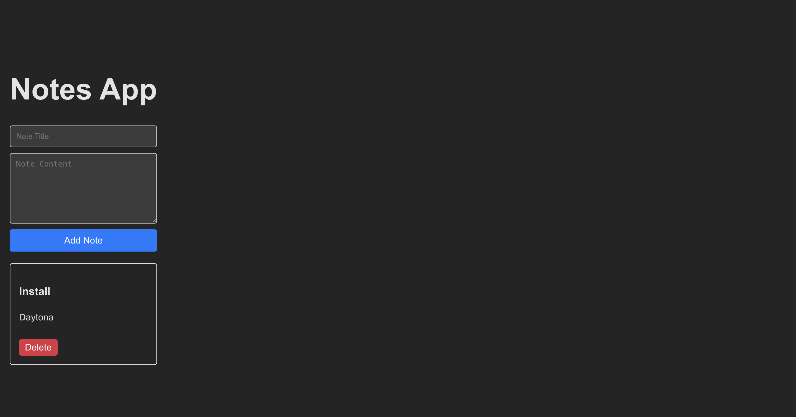

# Coding Agent Example (AgentKit + Daytona)

## Overview

This project demonstrates a fully autonomous coding agent capable of performing software development tasks in a [Daytona](https://daytona.io) sandbox environment. The agent is built using [AgentKit](https://agentkit.inngest.com/) and leverages Daytona sandboxes for secure, isolated execution. The agent can create simple web apps, run tests, execute scripts, and more - all by reasoning about the user's request and automating the necessary steps.

## Features

- **Multi-language support:** The agent can use any language supported by Daytona sandboxes
- **Web app creation:** Automatically scaffolds and builds simple web applications.
- **Dev server orchestration:** Detects when a development server is needed, starts it, and generates a preview link for live app inspection.
- **File and directory management:** Creates, uploads, reads, and deletes files and directories as needed.
- **Script and test execution:** Runs arbitrary scripts and test suites.
- **Automated reasoning:** Plans and executes multi-step development workflows based on user prompts.
- **Debug logging:** Detailed agent flow tracking, disabled by default and enabled by setting `ENABLE_DEBUG_LOGS=true`.

## Requirements

- **Node.js:** Version 22.4 or higher is required.
- **Daytona SDK:** `@daytona/sdk` 2.x (v2 namespace on this PoC branch), pinned to the pre-release `2.0.0-alpha.5` until 2.0.0 is stable; `npm install` installs the pinned version.
- Self-hosted / custom API URL: SDK 2.x targets Daytona Cloud only. If you need a custom API URL (self-hosted Daytona), keep using a release of this package that is built on Daytona SDK 0.x.

## Environment Variables

To run the coding agent, you need to set the following environment variables:

- `DAYTONA_API_KEY`: Required for access to Daytona sandboxes. Get it from [Daytona Dashboard](https://app.daytona.io/dashboard/keys)
- `ANTHROPIC_API_KEY`: Because Anthropic is the default model provider, you must set `ANTHROPIC_API_KEY` in your environment. By default the agent uses `claude-3-5-haiku-20241022` model with a preset token limit.

> [!Note] 
> You can change the token setting and the model (see all available Anthropic models at [AgentKit Supported Models](https://agentkit.inngest.com/concepts/models#list-of-supported-models)). To use a different model provider, follow the instructions at [AgentKit Model Setup](https://agentkit.inngest.com/concepts/models#create-a-model-instance).

See the `.env.example` file for the exact structure and variable names. Copy `.env.example` to `.env` and fill in your API keys before running the agent.


## Getting Started

Before proceeding with either Local or Docker setup, complete the following steps:
1. Clone this repository to your local machine
2. Change into the app directory: `cd apps/inngest-agentkit-coding-agent`
3. Copy `.env.example` to `.env` and add your API keys

### 1. Local Setup

1. Install dependencies:

   ```bash
   npm install
   ```

2. Run the agent:

   ```bash
   npm run start
   ```

### 2. Docker Setup

> [!Note]
> Your `.env` file is intentionally excluded from the image (via `.dockerignore`), so your API keys are never baked into the build. They are injected at runtime with `--env-file` instead (see the run command below).

1. Build the Docker image:

   ```bash
   docker buildx build . -t coding-agent
   ```

2. Run the container (API keys are injected at runtime from your `.env`):

   ```bash
   docker run --rm -it --env-file .env coding-agent
   ```


## Configuration

- **Prompt Setting:** The main prompt for the agent is configured in the `network.run(...)` call inside [`src/index.ts`](src/index.ts). You can edit this prompt to change the agent's task or try different app ideas and workflows.

- **Debug Logs:** Detailed agent flow tracking is disabled by default. Enable it by setting `ENABLE_DEBUG_LOGS=true` in your environment (for example, in your `.env` file). This will log all agent iterations and tool actions for transparency and troubleshooting.

## Example Usage

To showcase the agent, try running the default prompt in `src/index.ts`:

```typescript
const result = await network.run(
  `Create a minimal React app called "Notes" that lets users add, view, and delete notes. Each note should have a title and content. Use Create React App or Vite for setup. Include a simple UI with a form to add notes and a list to display them.`
);
```


The agent will:
- Scaffold the app
- Install dependencies
- Start the dev server
- Generate a preview link for you to view the app

You can inspect the terminal logs to monitor what the agent is doing, observe its evolution, and see how it corrects mistakes from errors during the process.

When the agent finishes, you should see terminal output like:

> ✔️ App is ready!
> Preview: https://5173-3a828150-1573-42e3-bf9f-9793a2c2c0c2.proxy.daytona.works

You can view the app on the given preview link above. The image below shows the result generated in this run:



## v2 PoC

This stacked branch ports sandbox creation, Python code execution, shell execution,
file/directory tools, session-based servers, command logs, previews and deletion to
`daytona.v2`. It does not run a mixed v0/v2 sandbox workflow.

Set **`DAYTONA_V2_IMAGE`** to a registered v2 image ID or name before creating a
sandbox (for example `DAYTONA_V2_IMAGE=img_<your-registered-image-id>`). No
platform default image is configured in the measured environment. The image
used for the readiness run (Debian, Python 3.12, home/cwd `/root`, user root)
has no Node, npm or curl.
Python execution and filesystem operations passed live; the autonomous React
agent loop was not run. The deployed daemon rejected session creation with HTTP
422 (`kind: session` unsupported), so the server flow is
`BLOCKED-BY-V2-GAP(sessions)`. A separate exec-handle diagnostic reached a listening
HTTP server but timed out reading logs before the preview request; preview HTTP
status remains unverified. To run the React example, supply a v2 image containing Node/npm;
this PoC neither builds images nor installs those guest tools.

Ledgered differences: interpreter `argv` has no v2 equivalent
(`BLOCKED-BY-V2-GAP(argv)`). The tool retains the parameter and returns an explicit
unsupported error when it contains arguments; `null` or an empty array runs the
code without arguments, as before. Use the shell tool for command-line arguments.
Interpreter stdout is `logs.stdout`, bulk writes report partial errors, and
session commands return process handles with channel-tagged log pages. Shell,
code and dev server commands have no deadline, as before. Health checks follow
the log cursor for at most 10 pages of 1000 frames and stop when caught up.
Private previews require the `X-Daytona-Preview-Token` header; the token is not
printed.

Full live evidence and call-by-call differences are retained in the migration
run's `inngest-agentkit-coding-agent/v2-ledger.md` (outside the branch).

## License

ISC

## References

- [AgentKit](https://agentkit.inngest.com/)
- [Daytona](https://daytona.io)
